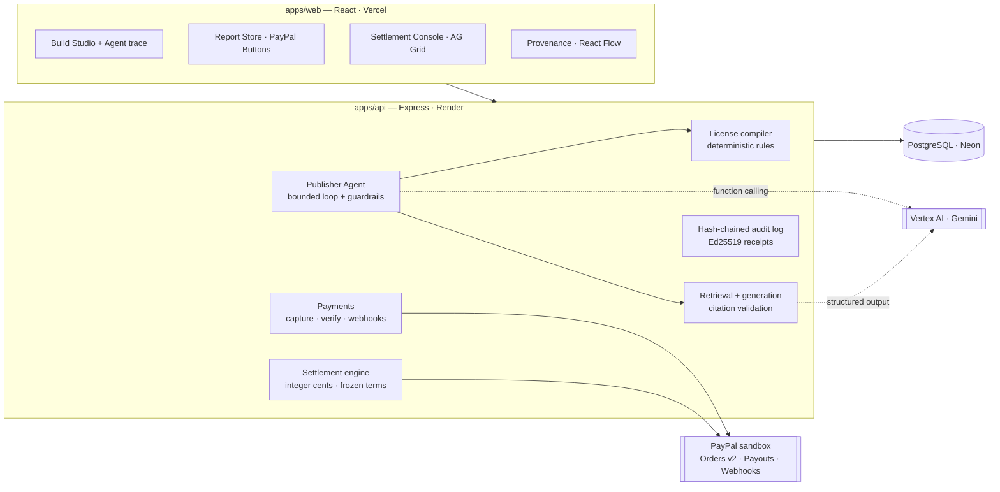

# TracePay

**The license compiler and settlement engine for AI-generated products.**

An AI can assemble a paid deliverable out of a dozen licensed sources in seconds. Nothing today checks whether those licenses actually allow that *specific* product to be sold, records which sources the output really used, or pays each contributor their agreed share when it sells. TracePay connects those three steps — and uses **PayPal** to collect the sale and pay the contributors.

> Built for the *Build What's Next with PayPal and AI* hackathon. Everything runs on the **PayPal sandbox** with **synthetic, fictional** demo data.


**Live demo:** [trace-pay-umber.vercel.app](https://trace-pay-umber.vercel.app) — PayPal sandbox; pick a demo role on the sign-in page.

---

## The story in 60 seconds

**Atlas Research Studio** wants to sell a *Developer Tools Market Brief* for **$20**, built from three licensed sources.

1. **Preflight blocks it.** One source — the *Kestrel Enterprise Panel* — is licensed for *internal research only*. TracePay's deterministic license compiler refuses the commercial build (`PURPOSE_ALLOWED`, `COMMERCIAL_USE`).
2. **The Publisher Agent recovers.** A Gemini agent finds a compatible replacement (*Open Developer Survey Digest*, $2 per sale), asks the publisher for approval, re-runs preflight — now **PASS** — and generates the report. It cannot override a failed rule, change the price, or move money.
3. **Every claim is traceable.** Each finding cites `[C1]`, `[C4]`… which resolve to the exact retrieved passage. Invented citations are rejected.
4. **A buyer pays with PayPal.** The server creates the order, captures it, and verifies amount, currency and sale reference against PayPal's response.
5. **Contributors are paid automatically — under the license terms in force at the moment of sale.**

   | Recipient | Rule (approved license) | Amount |
   |---|---|---|
   | Northwind Data Co. | 25% of gross | $5.00 |
   | Mara Okafor (analyst) | 15% of gross, *only if cited* | $3.00 |
   | Lumen Collective | $2.00 fixed per sale | $2.00 |
   | Atlas (publisher, merchant of record) | residual | $10.00 |

   After the publisher approves, one **PayPal Payouts** batch pays all three; statuses are read back from PayPal until each item reports `SUCCESS`.
6. **A signed receipt proves it.** One Ed25519-signed document links source versions → rights check → artifact → PayPal capture → settlement formula → payout status, on top of a hash-chained audit log.

---

## What makes it different

The innovation isn't splitting $20 — many systems can do that. It's that **the financial structure of the product is derived from its verified dependency trail**:

- **Rights are checked against the intended use, not just "has a license".** The same dataset can be allowed in a derived report and blocked the moment you add a raw-data appendix (`RAW_REDISTRIBUTION`).
- **Provenance drives payment.** A license can pay only when the final output *cites* the source; retrieved-but-uncited sources get $0 with a recorded reason.
- **Rights are re-checked at every sale, and terms are frozen per sale.** A report keeps selling only while every source's license still permits it; a revoked or expired license takes it off sale. Each sale settles under the terms in force when it happened — later renegotiations never rewrite it.
- **Evidence is never blurred.** Every node in the provenance graph is labeled as *verified by PayPal*, *recorded event*, *AI interpretation*, or *contractual* — a model's claim is never presented as a fact.

---

## Platform API & webhooks

Everything the dashboard does is also available to other software, so a company can plug TracePay into its own stack after the hackathon:

- **REST API at `/api/v1`** — sources and licenses, license preflight, citation-checked generation, reports, signed receipts and provenance, sales, settlements and PayPal payouts, Publisher Agent runs. **OpenAPI 3.1** at [`/api/v1/openapi.json`](https://trace-pay-umber.vercel.app/api/v1/openapi.json), browsable on the **Developers → API reference** page.
- **API keys** from the Developers page: full or read-only, optional expiry, revocable. Keys work only on `/api/v1` (never on the dashboard's own routes).
- **Signed webhooks** for 35+ event types (`sale.completed`, `settlement.created`, `payout_batch.updated`, `license.offered`, …): HMAC-SHA256 with timestamp, retries with backoff for about a day, secret rotation without downtime, a test button and a delivery log.
- **Safe to retry:** `Idempotency-Key` on every POST; cursor pagination; one error format with request ids; per-key rate limits.

```bash
curl https://tracepay-api.onrender.com/api/v1/sales?status=captured \
  -H "Authorization: Bearer tp_…"
```

---

## Screens

| | |
|---|---|
| **Build Studio** — rules × sources preflight matrix, Publisher Agent with live trace and approval card | **Provenance Explorer** — React Flow graph from source versions to payouts, colour-coded by evidence |
| **Report** — clickable citation chips open the cited passage | **Settlement Console** — AG Grid ledger: formula per line, payable flags, live PayPal payout status, pinned totals |
| **Report Store** — PayPal Smart Buttons, server-verified capture | **Audit Receipt** — signed, verifiable, downloadable |

---

## How PayPal is used

| PayPal capability | Where | Why it matters |
|---|---|---|
| **OAuth 2.0** client credentials | `integrations/paypal/client.ts` | Token caching; **Payouts scope detection** before promising payouts |
| **Orders v2** — create | `POST /api/checkout/orders` | Created server-side with `reference_id` = `custom_id` = sale id; `PayPal-Request-Id` idempotency |
| **Orders v2** — capture + get | `POST /api/checkout/:saleId/capture` | Server captures, then **verifies** amount, currency and `custom_id` under a row lock; handles `ORDER_ALREADY_CAPTURED` |
| **JS SDK Smart Buttons** | `apps/web/src/pages/Store.tsx` | Buyer approval only; the browser never decides payment state |
| **Payouts** — create batch | `POST /api/settlements/:id/payouts` | One batch per settlement; deterministic `sender_batch_id` recorded **before** the call, so a retry can never pay twice |
| **Payouts** — batch status | `POST /api/settlements/:id/refresh` | "Accepted" ≠ "paid": a run completes only when every item is `SUCCESS`; `FAILED`/`RETURNED`/… become exceptions |
| **Webhooks** + signature verification | `POST /api/webhooks/paypal` | Raw-body verification via `verify-webhook-signature`; deduped by event id; handles `PAYMENT.CAPTURE.COMPLETED/REFUNDED/REVERSED/DENIED` and payout events (status re-read from PayPal, never trusted from the payload) |
| **Captures** — get, and **reconciliation** | `modules/reconciliation/sync.ts` | TracePay doesn't depend on webhooks arriving: it re-reads every in-flight order, capture and payout batch from PayPal on a schedule (see below) |

### Reconciliation: TracePay checks PayPal itself

Webhooks can be missed — a sleeping server, a PayPal outage, a misconfigured endpoint. So every payment and payout batch still in flight carries the time of its next check, and a background worker asks PayPal directly:

| Situation | What TracePay does |
|---|---|
| Buyer approved in PayPal, then closed the tab before the capture | Captures it for them — after re-checking every license — so a paid-for report isn't lost |
| Checkout never finished | Keeps checking for 3 days, then closes it (buyer not charged); immediately if PayPal no longer has the order |
| Capture held as pending (e.g. an eCheck) | Follows it until PayPal completes it (sale + settlement) or declines it (needs attention) |
| Refund or partial refund made in the PayPal dashboard | Notices it (checks 1, 7, 30, 90 and 180 days after the sale), holds the settlement, asks for attention |
| Payout batch in progress | Polls every attempt until every payout is final (1 min → daily), then stops |
| Payout unclaimed, failed, returned, blocked, or batch denied | Opens a plain-language **Needs attention** item; clears it by itself once a retry or claim succeeds |
| Send interrupted mid-request | Finishes it with the same `sender_batch_id`, so PayPal can't pay twice |
| PayPal accepted a batch but its id never arrived | Tells a person after an hour; clears when the webhook brings the id |

Checks are claimed with leases (`SKIP LOCKED`), so several servers share the work without doing anything twice; PayPal errors back off instead of retrying in a loop; and the worker sleeps until the next scheduled check, so an idle deployment lets Neon suspend. Issues are available in the dashboard, at `GET /api/v1/reconciliation/issues`, and as `reconciliation.issue_opened` / `issue_resolved` webhooks.

## How AI is used (Vertex AI · Gemini)

| Role | What the model does | What it is **not** allowed to do |
|---|---|---|
| **Publisher Agent** (function calling) | Plans the build, calls 7 TracePay tools (`run_license_preflight`, `find_compatible_replacement`, `propose_replacement`, `generate_report`, …), recovers from a blocked plan | Override the compiler, preflight unapproved sources, change price/purpose, touch money — enforced in code, not in the prompt |
| **Report writer** (structured output) | Synthesises findings from retrieved passages with `[Cn]` citation markers | Cite anything not retrieved (validated; one repair attempt, then rejected) |
| **License drafter** (structured output) | Reads a contributor's license document and drafts normalized terms with a verbatim quote per field | Bind anyone — both parties confirm; quotes not found in the document are flagged |
| **Explainer** | Turns failed rules into plain language for the publisher | Change the verdict — the compiler's decision is returned, never the model's |

When Vertex AI isn't configured, TracePay falls back to a **rule-based planner** and an **extractive fixture writer**. Both are clearly labeled in the UI and in the receipt (`fromFixture: true`) and are never presented as model output.

---

## Architecture



**Money rules enforced in code:** integer cents only · only a verified captured sale creates a settlement · one settlement per sale · percentages over 100% are rejected, never normalized · publisher approval before payouts · retries reuse the same idempotency key · refunds/reversals flag the settlement as an exception.

---

## Real vs. simulated

| Real | Simulated / demo-only |
|---|---|
| PayPal sandbox Orders, capture, Payouts, webhooks | All sources, contributors and numbers are fictional |
| License compiler, settlement engine, audit chain, signatures | The seeded demo roles, reachable with one click when `DEMO_MODE=true` |
| Accounts: sign-up / sign-in, scrypt passwords, httpOnly sessions, API keys | |
| Vertex AI Gemini agent + writer (when configured) | Fixture writer / rule-based planner when Vertex is not configured — always labeled |
| PostgreSQL persistence | "Reset demo" restores TracePay fixtures; it does **not** reverse PayPal sandbox history |

TracePay enforces recorded, approved license terms. It does not establish legal ownership of source material, is not legal advice, and is not an escrow service — the publisher receives the payment and then pays contributors.

---

## Run it locally

**Prerequisites:** Node 20.19+ (24 recommended), Docker, a PayPal Developer account. Vertex AI is optional.

```bash
git clone https://github.com/UjjwalCodes01/TracePay.git && cd TracePay
npm install
npm run db:up                                  # Postgres 17 on localhost:5433

cp apps/api/.env.example apps/api/.env         # then fill in the values below
npm run keys:generate -w @tracepay/api         # paste AUDIT_SIGNING_PRIVATE_KEY into .env

npm run db:deploy -w @tracepay/api             # apply migrations
npm run db:seed -w @tracepay/api               # load the demo world

npm run dev:api                                # http://localhost:4000
npm run dev:web                                # http://localhost:5173
```

### Environment (`apps/api/.env`)

| Variable | Required | Notes |
|---|---|---|
| `DATABASE_URL` | yes | Local Docker URL, or Neon's **pooled** connection string (host contains `-pooler`) |
| `DATABASE_URL_UNPOOLED` | on Neon | Neon's **direct** connection string; used only by `prisma migrate` (needs session-level locks) |
| `PAYPAL_CLIENT_ID`, `PAYPAL_CLIENT_SECRET` | yes | **Sandbox** REST app. Enable *Payouts* in the app's features |
| `DEMO_PAYEE_EMAILS` | for payouts | Three sandbox **personal** account emails (Northwind, Okafor, Lumen) |
| `PAYPAL_WEBHOOK_ID` | for webhooks | Register `https://<api>/api/webhooks/paypal` in the dashboard |
| `GOOGLE_CLOUD_PROJECT`, `VERTEX_MODEL` | for live AI | Plus `gcloud auth application-default login` locally, or `GOOGLE_SERVICE_ACCOUNT_JSON` on a server |
| `AUDIT_SIGNING_PRIVATE_KEY` | yes | Ed25519 key from `npm run keys:generate` |
| `DEMO_MODE` | no (default `false`) | `true` enables the one-click demo roles and "Reset demo". **Keep `false` for real users** |
| `CORS_ORIGINS` | in production | The web app's origin(s); also used for the CSRF origin check |
| `RATE_LIMIT_PER_MINUTE`, `AUTH_RATE_LIMIT` | no | Defaults 300 req/min/IP and 20 sign-in attempts per 15 min/IP |
| `API_RATE_LIMIT_PER_MINUTE` | no | Platform API requests per minute per API key (default 600; twice that per account) |
| `WEBHOOK_SECRET_KEY` | recommended | 32 random bytes (base64/hex) encrypting webhook signing secrets at rest. Without it a key is derived from `AUDIT_SIGNING_PRIVATE_KEY`; adding or changing it later never breaks existing endpoints (old keys go in `WEBHOOK_SECRET_KEY_PREVIOUS`) |
| `WEBHOOK_ALLOW_PRIVATE_TARGETS` | no (default `false`) | Lets webhooks reach `http://` and private/loopback addresses. **Local development only** |
| `CLIENT_IP_HEADER` | no | Edge header with the visitor's IP; set automatically to `cf-connecting-ip` on Render |
| `TRUSTED_PROXY_SECRET` | recommended | Same value as the web app's Vercel env `TRACEPAY_PROXY_SECRET` (32+ characters). Vercel attaches it to the `/api` requests it forwards; with it, website visitors get per-visitor rate limits instead of sharing Vercel's addresses |

---

## Production readiness

TracePay is built to be adopted after the hackathon, not just demoed.

| Area | What's in place |
|---|---|
| **Accounts** | Sign-up / sign-in with **scrypt** password hashing (OWASP parameters, constant-time compare, timing-safe for unknown emails); server-side sessions in **httpOnly, SameSite=Lax, Secure** cookies — only a SHA-256 of the token is stored |
| **Platform API** | Versioned `/api/v1` described by OpenAPI 3.1, generated from the same declarations that validate requests (tests check every response against it); idempotency keys with heartbeat-held locks, cursor pagination, uniform errors with request ids |
| **API keys** | Hashed at rest, shown once, read-only or read & write, optional expiry, revocable; accepted only on `/api/v1`; guessing is throttled per address without ever blocking working keys; per-key and per-account rate limits |
| **Scaling out** | Rate limits and quotas are kept in process memory, which is exact for one instance (the current deployment). Before running several API instances, back them with a shared store (e.g. Redis) — webhook delivery and reconciliation already coordinate through Postgres (`SKIP LOCKED` leases) |
| **Webhooks** | Events written in the same transaction as the change (outbox); HMAC-SHA256 signatures with timestamps; AES-256-GCM encrypted secrets with overlap-safe rotation; SSRF checks at connection time (DNS rebinding, IPv4-mapped IPv6, no redirects); backoff retries, auto-disable after 3 days or `410 Gone`; leases + `SKIP LOCKED` so several servers never double-send; the worker sleeps when the API is idle so Neon can too |
| **Tenant isolation** | Every build, run, report, sale, settlement and audit event is scoped to its publisher. Other tenants get **404** (not 403), so they can't even confirm a record exists. Buyers see sourcing but not the money split; only the owner sees payout addresses |
| **Request security** | Helmet security headers and a locked-down CSP; CSRF origin check on cookie-authenticated writes; per-IP rate limits with stricter limits on credential endpoints; 1 MB body limit; zod validation on every input |
| **Money safety** | Integer cents, idempotency keys on every PayPal write, row locks on capture, terms frozen per sale, publisher approval before payouts, exceptions for refunds and failed payouts |
| **Reconciliation** | Scheduled, lease-based checks of every in-flight order, capture and payout batch against PayPal (no reliance on webhooks); refunds made outside TracePay detected; abandoned checkouts closed; interrupted payout sends finished safely; a "Needs attention" list that resolves itself when the cause clears |
| **Operability** | Structured JSON logs (pino) with request ids echoed in `X-Request-Id` and secrets redacted; `/api/health` (liveness) and `/api/ready` (database); graceful shutdown on SIGTERM; fail-fast config validation; a recovery sweep for work interrupted by a restart |
| **Database** | **Neon** serverless Postgres: the app uses the pooled endpoint, migrations the direct one; the pool survives compute suspend/resume; health checks and an idle API never wake the database; the seed script refuses to run once real accounts exist, and integration tests refuse non-local databases |
| **Self-service licensing** | Contributors register sources (immutable, fingerprinted versions) and offer terms; publishers request, accept or decline. Terms only bind once **both** parties agree, acceptance is tied to the exact terms hash reviewed, renegotiations never displace an active license until accepted, and revocation stops future builds without rewriting past settlements |
| **AI-drafted terms, human-decided** | Gemini drafts normalized terms from a license document, quoting the sentence behind every field; quotes are checked against the document. A deterministic extractor (restrictive by default, with warnings) covers the no-AI case. Nothing is enforced until confirmed by both sides |
| **Auditability** | Hash-chained, tenant-tagged audit log; Ed25519-signed receipts verifiable offline |
| **Delivery** | Versioned Prisma migrations (including data backfills), CI running typecheck + 251 tests against real Postgres, Render Blueprint, Vercel config |

In production the web app calls `/api/*` on its own origin; `apps/web/vercel.json` rewrites that to the Render API so session cookies stay first-party. Update the rewrite destination if your Render service URL differs.

### Deploying the database (Neon)

1. Create a Neon project (Postgres 17). In **Connect**, copy two strings: the **pooled** one (host contains `-pooler`) → `DATABASE_URL`, and the one with pooling switched off → `DATABASE_URL_UNPOOLED` (`neon env pull` writes both under these names).
2. Put both in the Render service's environment. On every deploy Render runs `prisma migrate deploy` over `DATABASE_URL_UNPOOLED` before starting.
For local development, `neon init` / `neon deploy` pull both strings into the repo-root `.env.local`; the API's dev, seed and migrate commands load it after `apps/api/.env`, so it takes precedence. Remove `.env.local` to go back to the local Docker database. Integration tests always use the local database.

3. Load the demo data once: `npm run db:seed -w @tracepay/api` with those variables set. It refuses to run once the database has real accounts; use **Reset demo** in the app instead, which only touches the demo personas.

Neon's free plan suspends the compute after a few idle minutes and wakes it on the next query (allow a second or two on the first request). Render's health check uses `/api/health`, which doesn't touch the database, so an idle deployment lets Neon sleep. On Render's free plan the API itself sleeps after 15 idle minutes: webhook retries that come due meanwhile are sent as soon as it wakes (it checks at boot and on the next signed-in request). Use a paid instance for punctual retries.

Check your PayPal setup before running the app:

```bash
npm run smoke:paypal -w @tracepay/api -- token          # auth + Payouts scope
npm run smoke:paypal -w @tracepay/api -- order          # prints an approval link
npm run smoke:paypal -w @tracepay/api -- capture <ORDER_ID>
npm run smoke:vertex -w @tracepay/api                   # Gemini structured output
```

### Demo walkthrough

1. **Publisher** → *Build Studio* → keep the default three sources → **Run agent**. Watch it get blocked, propose a replacement, and wait for you. **Approve** → report ready.
2. Open the report → click a citation chip → **Provenance**.
3. Switch role to **Buyer** → *Report Store* → **Pay with PayPal** (sandbox buyer account) → the report unlocks with the server-verified capture.
4. Switch back to **Publisher** → *Settlement Console* → **Approve** → **Send PayPal payouts** → **Refresh from PayPal**.
5. Open the **Audit Receipt** → **Verify signature**. Switch to a **Contributor** to see their own settlement record.

---

## Tests

```bash
npm run test:integration -w @tracepay/api   # 251 tests; creates/migrates a tracepay_test database
```

| Suite | Covers |
|---|---|
| License compiler (14) | block/pass, replacement, internal-only, raw-redistribution adversarial case, expiry, territory, >100% royalties, determinism |
| Settlement engine (9) | exact $20 split, reconciliation for any amount, paid-only-if-cited, fixed fees, rejection cases |
| Citations · audit · signing · money (7) | invented citation rejected, hash chain tamper detection, signature tamper detection, decimal ↔ cents |
| PayPal client (6) | same idempotency key on retry, payout POST never auto-retried, deadline on every call, no retry on 4xx, raw-body webhook verification, Payouts scope |
| Build pipeline (5) | recorded blocked builds, retrieval scoped to approved sources, citation integrity |
| Money path (20) | capture before approval, duplicate webhooks, webhook-before-response, forged-then-genuine webhook ids, reprocessing a half-applied webhook, amount mismatch, **sale-time terms that later edits never touch**, expired license blocks the sale, capture recorded even when settlement fails, no double purchase, **concurrent payout clicks send once**, denied batches, refunds stay exceptions, **lost payout response recovered via webhook**, missing Payouts permission |
| Hardening (20) | no source text or payout addresses in builds or purchase lists, per-viewer provenance and receipts, refunds never undone or dropped, partial refunds, revocation closes pending offers, new credit requirements stop sales, generation and capture-time license re-checks, unreadable stored terms, payout retry with history, settlement recalculation, interrupted-work recovery, scoped demo reset, demo header limited to personas, cross-site writes, per-account login lockout, checkout reuse, price limits |
| Publisher agent (5) | recovery, approval pause, decline, guardrail violations, turn limit |
| Security (16) | sign-up/sign-in/sign-out, hashed passwords and sessions, no account enumeration, rate limits, demo mode off, cross-tenant 404s on every resource, role-appropriate provenance views, API keys, CSRF, security headers, readiness |
| License extraction (13) | the rule-based extractor reproduces all five demo licenses' approved terms; restrictive defaults with warnings; end date read after "until"; impossible percentages; thousands separators; expired documents; schema normalisation |
| Licensing lifecycle (9) | source registration, private marketplace listings, request → offer → accept, hash-bound acceptance, renegotiation, decline/withdraw, revocation vs. frozen settlement, contributor isolation, audit trail |
| HTTP end-to-end (3) | the full demo script, the agent with an approval pause, and a forged webhook — through the REST API |
| Database URL (2) | hosted `sslmode=require` URLs are pinned to full certificate verification |
| Platform API (35) | key auth (unknown, revoked, expired, read-only, wrong role, dashboard-only routes), the whole publisher flow over `/v1`, tenant isolation on every resource, pagination without gaps or duplicates, idempotent replay / reuse / in-flight / takeover, error envelope, malformed JSON, per-key limits, key-guessing throttle, OpenAPI completeness |
| Webhooks (35) | signed delivery to subscribed endpoints only, no event on rollback, backoff then give-up, redirects, `410`, 3-day auto-disable, SSRF and DNS rebinding at send time, concurrent workers and leases, pings, secret rotation, redelivery, pruning, demo reset, NUL bytes in responses, crashing attempts, atomic failure streaks, lost leases, concurrent resends/rotations, secrets never stored for replay, agent-run cap races, idle-friendly wake-ups |
| Reconciliation (35) | approved-then-abandoned checkouts captured (license re-checked, within the 2-hour window only), never a double charge when the buyer starts over, never for a report off sale, abandoned and forgotten checkouts closed (double "not found"), pending captures completed or declined, refunds and partial refunds made in PayPal detected once, money captured after a checkout closed flagged, payouts polled to the end across attempts, unclaimed/failed/denied/unconfirmed payouts flagged and auto-cleared, interrupted sends finished safely and never past 25 days, stale refreshes can't undo a retry, "Check now" never ends the refund watch, PayPal outages back off, schedules always end, leases, the worker, the API |
| Platform units (17) | signature verification and replay window, secret encryption and key rotation, address classification, URL rules, safe POST (timeouts, truncation, no redirects, rebinding), event catalog |

---

## Project layout

```
apps/api      Express API, Prisma schema & migrations, services, tests
apps/web      React app (Vite, Tailwind, React Router, TanStack Query, AG Grid, React Flow)
packages/shared  Money helpers and zod schemas shared by API and web
render.yaml   Render Blueprint (API; database on Neon); apps/web/vercel.json for the frontend
```

## Tools used

- **PayPal Developer Platform (sandbox):** Orders v2, JS SDK Smart Buttons, Payouts, Webhooks.
- **Google Vertex AI (Gemini):** function-calling agent, structured-output report writer, failure explanations — via `@google/genai`.
- **AG Grid Community:** registry and settlement ledger. **React Flow:** provenance graph.
- **Render** (API), **Neon** (serverless Postgres) and **Vercel** (web).
- Node.js, TypeScript, Express 5, Prisma 7, PostgreSQL 17, React 19, Tailwind CSS 4, Vitest.

## License

[MIT](LICENSE)
