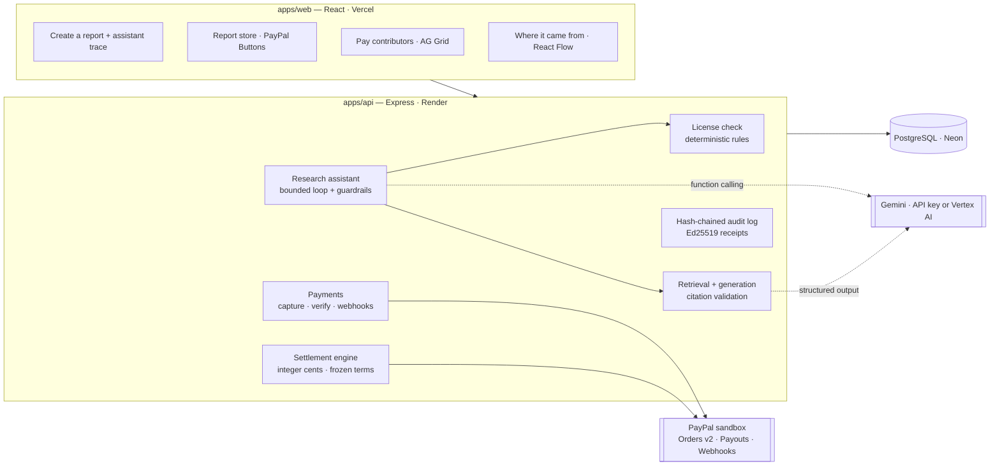

# TracePay

**AI answers and reports that use only what they're licensed to use — and pay each source's contributor, through PayPal, for every citation that holds up.**

AI is built on people's work, and licenses are mostly ignored: a "non-commercial" dataset ends up in a paid answer, an expired license keeps being used, and the people whose work the answer relied on see nothing. Products already pay creators when AI uses their work (pay-per-crawl, revenue shares). TracePay's difference is what happens *before and after* the model runs:

1. **Before:** every source's license is checked against the exact use — paid or internal, AI answers allowed, still in force, territory, original data shared or not — and a source that fails is **never even shown to the model**. Text planted in a source to steer the AI is screened out too.
2. **After:** each citation is checked by an independent AI judge; only citations that hold up are paid, at the terms frozen at that moment, with **PayPal** (prepaid credit in, PayPal Payouts out). Every answer and sale gets an **Ed25519-signed receipt**.

**Who it's for:** libraries and publishers of licensed content (research firms, data vendors) that want to sell AI answers and reports built from it; the contributors who license their work to them; and buyers — or the AI agents buying for them.

**Try it:** [trace-pay-umber.vercel.app](https://trace-pay-umber.vercel.app) — no sign-up; you get **your own private copy of the demo**, with a sample report already in its store (so a buyer has something to buy first; it doesn't count towards the publisher's own steps). PayPal **sandbox** buyer (test money only): `tp-buyer-8fjk@personal.example.com` / `2I2oZGc!` (also shown next to the PayPal buttons; or pay with a [sandbox test card](https://developer.paypal.com/tools/sandbox/card-testing/)). Free hosting: the first visit can take up to a minute to wake the API.

### The 3-minute path

1. **Buyer → Ask the library.** Ask a question. See which licensed passages the answer used, *who was paid how many cents and why*, which sources were left out (and why), and the signed receipt. Click a citation to see the judge's reason. *Can the AI be gamed?* shows the latest red-team results, misses included.
2. **Publisher → Answer royalties → Pay … with PayPal.** Contributors' earnings go out in one PayPal Payouts batch; statuses are read back from PayPal.
3. **Contributor → My earnings.** What each answer and each sale paid them, under which terms.

Also in the box (the dashboard's guided tour walks through it): **an AI shopping assistant that pays on its own, within a spending mandate** — the buyer saves PayPal once (PayPal Vault) with a most-per-purchase, a most-in-total and an end date, checked on the server before every charge; outside agents get the same through our MCP server — **Gemini drafting exact license terms from a messy contract** (quoting the sentence behind each term; nothing binds until both sides agree), the license check blocking a report and the research assistant proposing a licensed replacement, a report store with PayPal checkout, and a platform API with signed webhooks.

> Built for the *Build What's Next with PayPal and AI* hackathon. Everything runs on the **PayPal sandbox**; the demo library is fictional.


---

## Pay-per-citation: AI answers that pay the people they rely on

How an answer is checked, priced and paid:

1. A buyer, or their AI agent (Claude Desktop through our MCP server, or any app through the API), holds **prepaid credit bought with PayPal**.
2. They ask a question and set the most it may cost.
3. A **license check** (fixed rules, no AI) decides which sources may be used: only licenses that allow AI answers, are current, allow commercial use and have a contributor who can be paid. Revoked, expired or "no AI" sources are never even retrieved.
4. Sources are **fitted to the price limit before the model runs**, at their worst-case cost, and that amount is held from the balance — so an answer can never cost more than the limit, and concurrent answers can never overspend.
5. Gemini writes the answer from those passages only, citing `[C1]`, `[C2]`…
6. **Citations are audited, not trusted.** An invented source rejects the answer (free). A citation is paid only if its sentence really draws on the passage; each passage is paid once, at most 3 per source. A small fee goes to the library.
7. A separate AI judge checks every citation (embeddings as a floor, then Gemini seeing only the sentence and the passages it cites); only citations it confirms are paid. A sentence that combines two sources pays both; a source cited as padding, or a sentence that adds a claim none of its sources make, pays nothing. Each contributor's earnings add up; the library pays them in one **PayPal Payouts** batch (idempotent, failed items return to the pool). The asker gets an **Ed25519-signed receipt** of who was paid, under which license terms — and of every citation verdict with its reason, and exactly which judge made them (version, model, SHA-256 of its instructions, temperature).

   *Can a model's payout decision be disputed?* A model can't be re-run bit for bit, so TracePay doesn't pretend it can: the receipt is the record. It fixes what was decided, by which judge and instructions, and why, for each sentence (hashed) and passage (by id). A contributor who disputes a verdict points to that line, and the library reviews it against the same judge version, sentence and passage (today by hand). Receipts and the credit ledger are append-only, so a correction is a new entry beside the original, never an edit to it. Two guardrails make a wrong verdict cheap: the embedding floor means nothing unrelated is ever paid whatever the model says, and the most any verdict moves is one passage's per-citation rate (2¢ in the demo).

**Red team — "Can the AI be gamed?"** A larger model than the defences, `gemini-3.1-pro-preview`, plays the attacker (`npm run red-team`), so attacker and defender don't share blind spots; it writes fresh attacks against the two AI checks (which run on `gemini-3.5-flash`), plus honest controls, and the real checks are scored — every miss published on the Ask page. Latest run: **30/30 planted instructions withheld** (varied phrasing, several languages; a fixed word list alone caught 4), **30/30 unsupported citations refused** (topic-only, changed numbers, flipped claims, borrowed facts, true facts with invented details), **10/10 padded citations refused** (a second source cited for a vague clause), **10/10 sentences combining two sources paid to both**, 17/20 honest paraphrases paid, and 9/15 tricky honest passages left alone — the six withheld are imperatives such as "Format the output as a bulleted list" that would steer the writer, so the screen errs towards leaving them out (a withheld passage is only left out of the answer). Every miss is shown with the checker's reason. Separately, the money rules that need no AI (budget held before the model runs, padding, invented sources, per-source cap, verbatim copying) are checked on every request.

**Built so nobody can game it:** an unpaid answer never returns its text (no free licensed content); passages that try to instruct the model are withheld from it; answers that copy a source word for word are rejected (licenses forbid raw redistribution); demo credit only ever pays the demo's own contributors; royalties wait a clearing period before payout, and a refund or chargeback claws back the ones its money funded.

| Who | Where |
|---|---|
| Buyer / AI agent | *Ask the library* · `POST /api/v1/answers` (402 when credit runs out) · MCP tool `ask_library` |
| Contributor | License terms gain an *AI answers* clause (cents per cited passage); *My earnings → From AI answers* |
| Library (publisher) | *Answer royalties*: owed per contributor, one-click PayPal payout, statuses read back from PayPal |

---

## Also included: licensed reports, sold with PayPal

**Atlas Research Studio** wants to sell a *Developer Tools Market Brief* for **$20**, built from three licensed sources.

1. **The license check blocks it.** One source — the *Kestrel Enterprise Panel* — is licensed for *internal research only*. TracePay's license check (fixed rules, no AI) refuses a report that will be sold.
2. **The research assistant recovers.** It asks the license check which sources would pass in place of the blocked one; those come back ranked by relevance to the brief, then cost. It proposes the best — a **real paper under CC BY 4.0** (*Sea Change in Software Development*, Dohmke, Iansiti & Richards, 2023: free, with a credit line) — asks the publisher for approval, re-runs the license check — now **passed** — and writes the report. It cannot override a failed rule, change the price, or move money.
3. **Every claim is traceable.** Each finding cites `[C1]`, `[C4]`… which resolve to the exact retrieved passage. Invented citations are rejected.
4. **A buyer's AI pays for them — within a mandate.** The buyer **saves PayPal once for their shopping assistant with a spending mandate** (most per purchase, most in total, an end date; PayPal Vault). The assistant (Gemini) searches the store for what they asked for, re-runs the license check on each candidate, checks its citations, picks one and **pays on its own** — the mandate checked on the server before every charge, the amount reserved under a lock so two purchases can't both squeeze in. Without a mandate it proposes and the buyer approves in PayPal. Either way, the server creates the PayPal order, takes the payment, and verifies amount, currency and sale reference against PayPal's response.
5. **Contributors are paid automatically — under the license terms in force at the moment of sale.**

   | Recipient | Rule (approved license) | Amount |
   |---|---|---|
   | Northwind Data Co. | 25% of each sale | $5.00 |
   | Mara Okafor (analyst) | 15% of each sale, *only if cited* | $3.00 |
   | Dohmke, Iansiti & Richards (arXiv:2306.15033) | CC BY 4.0: free, credited in the report | $0.00 |
   | Atlas (the publisher, who sold it) | what's left | $12.00 |

   After the publisher approves, one **PayPal Payouts** batch pays the contributors who are owed; statuses are read back from PayPal until each item reports `SUCCESS`.
6. **A signed receipt proves it.** One Ed25519-signed document links source versions → license check → report → PayPal payment → payment split → payout status, on top of a hash-chained audit log.

---

## Real licenses, not just made-up ones

Alongside its fictional commercial sources, the demo library holds **five real open-access papers on AI coding assistants, under their actual licenses** (the stored passages are their arXiv abstracts, which arXiv releases as CC0; each paper's own license governs its use):

| Paper | License | What TracePay does |
|---|---|---|
| Ziegler et al., 2022 (arXiv:2205.06537); Dohmke, Iansiti & Richards, 2023 (arXiv:2306.15033) | CC BY 4.0 | Used in paid answers and reports for free, **with the credit line the license requires** |
| Nam et al., 2023 (arXiv:2307.08177) | CC BY-NC-SA 4.0 | Left out of anything sold: "The license doesn’t allow use in anything that is sold (CC BY-NC-SA 4.0)" |
| Sarkar et al., 2022 (arXiv:2208.06213) | CC BY-NC-ND 4.0 | No AI answers (an answer is an adaptation) and no reports |
| Peng et al., 2023 (arXiv:2302.06590) | arXiv's distribution-only license | No license to reuse it: it is never a candidate, never shown to a model |

Their authors haven't joined TracePay, so nothing is paid to them and no account speaks for them; the payment side of the demo uses the fictional contributors.

## What makes it different

The innovation isn't splitting $20 — many systems can do that. It's that **the financial structure of the product is derived from its verified dependency trail**:

- **Rights are checked against the intended use, not just "has a license".** The same dataset can be allowed in a derived report and blocked the moment you add an appendix of the original data.
- **Where it came from drives payment.** A license can pay only when the final output *cites* the source; retrieved-but-uncited sources get $0 with a recorded reason.
- **Rights are re-checked at every sale, and terms are frozen per sale.** A report keeps selling only while every source's license still permits it; a revoked or expired license takes it off sale. Each sale settles under the terms in force when it happened — later renegotiations never rewrite it.
- **Answers pay per verified citation.** Pay-per-citation turns the same dependency trail into a royalty stream for AI answers — with the price limit enforced before the model runs.
- **Evidence is never blurred.** Every node in the *Where it came from* graph is labeled as *verified by PayPal*, *recorded event*, *AI interpretation*, or *contractual* — a model's claim is never presented as a fact.

---

## Platform API & webhooks

Everything the dashboard does is also available to other software, so a company can plug TracePay into its own stack after the hackathon. (In the API, *preflight* = license check, *settlement* = the contributors' payment split, *artifact* = report, *capture* = a PayPal payment.)

- **REST API at `/api/v1`** — sources and licenses, license preflight, citation-checked generation, reports, signed receipts and provenance, sales, settlements and PayPal payouts, research-assistant runs, and **buying** for buyer accounts (search, license check, PayPal checkout). **OpenAPI 3.1** at [`/api/v1/openapi.json`](https://trace-pay-umber.vercel.app/api/v1/openapi.json), browsable on the **Developers → API reference** page.
- **API keys** from the Developers page: full or read-only, optional expiry, revocable. Keys work only on `/api/v1` (never on the dashboard's own routes).
- **Signed webhooks** for 35+ event types (`sale.completed`, `settlement.created`, `payout_batch.updated`, `license.offered`, …): HMAC-SHA256 with timestamp, retries with backoff for about a day, secret rotation without downtime, a test button and a delivery log.
- **Safe to retry:** `Idempotency-Key` on every POST; cursor pagination; one error format with request ids; per-key rate limits.

```bash
curl 'https://tracepay-api.onrender.com/api/v1/sales?status=captured' \
  -H "Authorization: Bearer tp_…"
```

---

### AI agents can shop too (MCP)

[`packages/mcp`](packages/mcp) is an **MCP server** that lets any AI agent — Claude Desktop, an IDE agent — shop for a buyer through the Platform API's **Buying** endpoints (`/store/reports`, `/checkouts`): search, re-check licenses, and buy. **It pays only what the buyer allowed:** within the buyer's spending mandate it pays at once with their saved PayPal (`POST /v1/checkouts` with `pay_with_mandate`); otherwise it hands the buyer PayPal's approve link and only completes a checkout they approved. It refuses anything over its own price cap either way. Buyers create the key on *Connect an AI agent*.

## Screens

| | |
|---|---|
| **Create a report** — license check of every rule × source, research assistant with live trace and approval card | **Where it came from** — React Flow graph from source versions to payouts, colour-coded by evidence |
| **Report** — clickable citation chips open the cited passage | **Pay contributors** — AG Grid ledger: how each share was worked out, live PayPal payout status, totals |
| **Report store** — PayPal Smart Buttons, payment verified on the server | **Receipt** — signed, verifiable, downloadable |

---

## How PayPal is used

| PayPal capability | Where | Why it matters |
|---|---|---|
| **OAuth 2.0** client credentials | `integrations/paypal/client.ts` | Token caching; **Payouts scope detection** before promising payouts |
| **Orders v2** — create | `POST /api/checkout/orders` | Created server-side with `reference_id` = `custom_id` = sale id; `PayPal-Request-Id` idempotency |
| **Orders v2** — capture + get | `POST /api/checkout/:saleId/capture` | Server captures, then **verifies** amount, currency and `custom_id` under a row lock; handles `ORDER_ALREADY_CAPTURED` |
| **JS SDK Smart Buttons** | `apps/web/src/pages/Store.tsx` | Buyer approval only; the browser never decides payment state |
| **Payouts** — create batch | `POST /api/settlements/:id/payouts` | One batch per settlement; deterministic `sender_batch_id` recorded **before** the call, so a retry can never pay twice |
| **Payouts** — batch status | `POST /api/settlements/:id/refresh` | "Accepted" ≠ "paid": a run completes only when every item is `SUCCESS`; `FAILED`/`RETURNED`/… become exceptions |
| **Webhooks** + signature verification | `POST /api/webhooks/paypal` | Raw-body verification via `verify-webhook-signature`; deduped by event id; handles `PAYMENT.CAPTURE.COMPLETED/REFUNDED/REVERSED/DENIED` and payout events (status re-read from PayPal, never trusted from the payload) |
| **Captures** — get, and **reconciliation** | `modules/reconciliation/sync.ts` | TracePay doesn't depend on webhooks arriving: it re-reads every in-flight order, capture and payout batch from PayPal on a schedule (see below) |

### Reconciliation: TracePay checks PayPal itself

Webhooks can be missed — a sleeping server, a PayPal outage, a misconfigured endpoint. So every payment and payout batch still in flight carries the time of its next check, and a background worker asks PayPal directly:

| Situation | What TracePay does |
|---|---|
| Buyer approved in PayPal, then closed the tab before the capture | Captures it for them — after re-checking every license — so a paid-for report isn't lost |
| Checkout never finished | Keeps checking for 3 days, then closes it (buyer not charged); immediately if PayPal no longer has the order |
| Capture held as pending (e.g. an eCheck) | Follows it until PayPal completes it (sale + settlement) or declines it (needs attention) |
| Refund or partial refund made in the PayPal dashboard | Notices it (checks 1, 7, 30, 90 and 180 days after the sale), holds the settlement, asks for attention |
| Payout batch in progress | Polls every attempt until every payout is final (1 min → daily), then stops |
| Payout unclaimed, failed, returned, blocked, or batch denied | Opens a plain-language **Needs attention** item; clears it by itself once a retry or claim succeeds |
| Send interrupted mid-request | Finishes it with the same `sender_batch_id`, so PayPal can't pay twice |
| PayPal accepted a batch but its id never arrived | Tells a person after an hour; clears when the webhook brings the id |

Checks are claimed with leases (`SKIP LOCKED`), so several servers share the work without doing anything twice; PayPal errors back off instead of retrying in a loop; and the worker sleeps until the next scheduled check, so an idle deployment lets Neon suspend. Issues are available in the dashboard, at `GET /api/v1/reconciliation/issues`, and as `reconciliation.issue_opened` / `issue_resolved` webhooks.

## How AI is used (Gemini)

| Role | What the model does | What it is **not** allowed to do |
|---|---|---|
| **Research assistant** (function calling, publisher side) | Plans the build, calls 7 TracePay tools (`run_license_preflight`, `find_compatible_replacement`, `propose_replacement`, `generate_report`, …), recovers from a blocked plan | Override the license check, check unapproved sources, change price/purpose, touch money — enforced in code, not in the prompt |
| **Shopping assistant** (function calling, buyer side) | Searches the store, compares and inspects candidates (fresh license check, citation check) and decides which report best serves the buyer — and, within the buyer's **spending mandate**, buys it with their saved PayPal | Exceed the budget or the mandate, see the saved wallet, or buy a report it hasn't verified, already owned or off sale — enforced in code; outside the mandate the buyer approves in PayPal |
| **Answer writer** (structured output, pay-per-citation) | Answers a question from licensed passages only, citing `[Cn]` | Decide who is paid: an independent judge does, and the money rules (retrieved, de-duplicated, capped, within the asker's limit) are code; text inside a source is data, never instructions |
| **Citation judge** (embeddings + structured output) | For each sentence, decides passage by passage whether it really draws on each passage it cites — naming the fact each one supplies and any claim none of them make (paraphrases and combined sources count; topic-only, padded, misquoted and embellished claims don't), with a plain reason | See the question, prices or names; overrule the semantic floor (`gemini-embedding-001`), below which nothing is paid |
| **Passage screen** (structured output) | Reads each source passage once, in any language, and flags text addressed to AI systems (planted instructions) so it is never shown to a writer | Be skipped: without a verdict the pattern list decides |
| **Red team** (`npm run red-team`) | Plays the attacker on a different, larger model (`gemini-3.1-pro-preview`): writes fresh planted instructions, unpayable and padded citations, plus honest controls (including sentences combining two sources), to score the screen and the judge | Grade itself: the real defences run at temperature 0 and every miss is published |
| **Report writer** (structured output) | Synthesises findings from retrieved passages with `[Cn]` citation markers | Cite anything not retrieved (validated; one repair attempt, then rejected) |
| **License drafter** (structured output) | Reads a contributor's license document and drafts normalized terms with a verbatim quote per field | Bind anyone — both parties confirm; quotes not found in the document are flagged |
| **Explainer** | Turns failed rules into plain language for the publisher | Change the verdict — the license check's decision is returned, never the model's |

When no Gemini model is configured (neither `GEMINI_API_KEY` nor Vertex AI), TracePay falls back to a **rule-based planner** and an **extractive fixture writer**. Both are clearly labeled in the UI and in the receipt (`fromFixture: true`) and are never presented as model output.

---

## Architecture



**Money rules enforced in code:** integer cents only · only a verified captured sale creates a settlement · one settlement per sale · percentages over 100% are rejected, never normalized · publisher approval before payouts · retries reuse the same idempotency key · refunds/reversals flag the settlement as an exception.

---

## Money: fees, and why PayPal is used this way

PayPal's US rates (Oct 2026): checkout **3.49% + $0.49**; Payouts API **$0.25 per payout**; micropayments pricing 4.99% + $0.09.

| Flow | What it costs | How TracePay keeps it sane |
|---|---|---|
| A $20 report sale | $1.19 PayPal fee, paid by the publisher (shown on *Pay contributors*, read from PayPal's capture) | Contributors' shares are worked out from what PayPal actually confirmed |
| Answer credit | A $5 top-up loses 13% to the fixed fee; $20 loses 6%; $50 loses 4.5% | Top-ups start at $5 and the app suggests $10–$50; each answer then spends credit cent by cent with **no** PayPal fee. A production library with many tiny top-ups would use PayPal's micropayments pricing |
| Royalties to contributors | $0.25 per payout | Earnings accrue and are paid in one PayPal Payouts batch once a contributor is owed **$10** (2.5% in fees); `ROYALTY_PAYOUT_MIN_CENTS` sets it. The demo pays from 1¢ so visitors can watch it happen |

**Why Payouts, not a split at checkout.** Today the publisher is the merchant: the buyer pays them, and they pay contributors with PayPal Payouts after approving the split. That works with a standard PayPal business account, and it lets a refund or chargeback claw back unpaid shares before anyone is paid. For a marketplace at scale, the production path is **PayPal Multiparty** (PayPal Complete Payments for platforms): contributors onboard as sellers, and each sale is split at capture with platform fees, so TracePay never holds anyone's money. The license check, the frozen terms and the receipts stay exactly as they are; only the last step changes.

**Holding balances.** Prepaid answer credit is money held for future use and paid on to third parties. In production that needs the right structure (PayPal Multiparty with the library as merchant of record, or a licensed partner holding the funds) and, depending on the jurisdiction, money-transmission licensing. The hackathon build runs only on the PayPal sandbox.

## Real vs. simulated

| Real | Simulated / demo-only |
|---|---|
| PayPal sandbox Orders, capture, Payouts, webhooks (including answer-credit top-ups and per-citation royalty payouts) | All sources, contributors and numbers are fictional |
| License check, payment-split engine, audit chain, signatures | The seeded demo roles, reachable with one click when `DEMO_MODE=true` |
| Accounts: sign-up / sign-in, scrypt passwords, httpOnly sessions, API keys | |
| Gemini agents and writers, through a Gemini API key or Vertex AI (when configured) | Fixture writer / rule-based planner when Gemini is not configured — always labeled |
| PostgreSQL persistence | "Reset demo" restores TracePay fixtures; it does **not** reverse PayPal sandbox history |

TracePay enforces recorded, approved license terms. It does not establish legal ownership of source material, is not legal advice, and is not an escrow service — the publisher receives the payment and then pays contributors.

---

## Run it locally

**Prerequisites:** Node 24 (see `.node-version`; the MCP server runs TypeScript directly), Docker, a PayPal Developer account. Gemini (an API key or Vertex AI) is optional.

```bash
git clone https://github.com/UjjwalCodes01/TracePay.git && cd TracePay
npm install
npm run db:up                                  # Postgres 17 on localhost:5433, Redis on :6380

cp apps/api/.env.example apps/api/.env         # then fill in the values below
npm run keys:generate -w @tracepay/api         # paste AUDIT_SIGNING_PRIVATE_KEY into .env

npm run db:deploy -w @tracepay/api             # apply migrations
npm run db:seed -w @tracepay/api               # load the demo world

npm run dev:api                                # http://localhost:4000
npm run dev:web                                # http://localhost:5173
```

### Environment (`apps/api/.env`)

| Variable | Required | Notes |
|---|---|---|
| `DATABASE_URL` | yes | Local Docker URL, or Neon's **pooled** connection string (host contains `-pooler`) |
| `DATABASE_URL_UNPOOLED` | on Neon | Neon's **direct** connection string; used only by `prisma migrate` (needs session-level locks) |
| `PAYPAL_CLIENT_ID`, `PAYPAL_CLIENT_SECRET` | yes | **Sandbox** REST app. Enable *Payouts* in the app's features |
| `DEMO_PAYEE_EMAILS` | for payouts | Three sandbox **personal** account emails (Northwind, Okafor, Lumen) |
| `PAYPAL_WEBHOOK_ID` | for webhooks | Register `https://<api>/api/webhooks/paypal` in the dashboard |
| `GEMINI_API_KEY` | for live AI | A Gemini API key from [Google AI Studio](https://aistudio.google.com/apikey); `GEMINI_MODEL` optional (default `gemini-flash-latest`) |
| `GOOGLE_CLOUD_PROJECT`, `VERTEX_MODEL`, `GOOGLE_CLOUD_LOCATION` | or, for live AI | Vertex AI instead of an API key (the hosted demo uses `gemini-3.5-flash` on the `global` endpoint): `gcloud auth application-default login` locally; on a server, `GOOGLE_SERVICE_ACCOUNT_JSON` (base64 key of a service account with only *Vertex AI User*) — without it, production treats AI as not configured |
| `AUDIT_SIGNING_PRIVATE_KEY` | yes | Ed25519 key from `npm run keys:generate` |
| `DEMO_MODE` | no (default `false`) | `true` enables the one-click demo roles and "Reset demo". **Keep `false` for real users** |
| `DEMO_SHARED_BUYER` | no (default `false`) | With `DEMO_MODE`, for a hosted demo many people visit: the demo buyer may buy a report again and its demo credit refills, so every visitor can try checkout and AI answers. Demo credit still only pays the demo's own contributors |
| `PAYPAL_SANDBOX_BUYER_HINT` | no | Demo mode only: the sandbox buyer login shown next to the PayPal buttons, so visitors can complete a test payment |
| `APP_BASE_URL`, `API_BASE_URL` | in production | The public web address (PayPal return URLs, CSRF) and the API's own public address (OpenAPI servers) |
| `CORS_ORIGINS` | in production | The web app's origin(s); also used for the CSRF origin check |
| `RATE_LIMIT_PER_MINUTE`, `AUTH_RATE_LIMIT` | no | Defaults 300 req/min/IP and 20 sign-in attempts per 15 min/IP |
| `API_RATE_LIMIT_PER_MINUTE` | no | Platform API requests per minute per API key (default 600; twice that per account) |
| `WEBHOOK_SECRET_KEY` | recommended | 32 random bytes (base64/hex) encrypting webhook signing secrets at rest. Without it a key is derived from `AUDIT_SIGNING_PRIVATE_KEY`; adding or changing it later never breaks existing endpoints (old keys go in `WEBHOOK_SECRET_KEY_PREVIOUS`) |
| `WEBHOOK_ALLOW_PRIVATE_TARGETS` | no (default `false`) | Lets webhooks reach `http://` and private/loopback addresses. **Local development only** |
| `CLIENT_IP_HEADER` | no | Edge header with the visitor's IP; set automatically to `cf-connecting-ip` on Render |
| `TRUSTED_PROXY_SECRET` | recommended | Same value as the web app's Vercel env `TRACEPAY_PROXY_SECRET` (32+ characters). Vercel attaches it to the `/api` requests it forwards; with it, website visitors get per-visitor rate limits. Best effort: Vercel was measured not to strip client-supplied IP headers reliably on forwarded requests, so the reported address is used only for rate limiting, and a hard cap per Vercel address (which can't be forged) stays in place |

---

## Production readiness

TracePay is built to be adopted after the hackathon, not just demoed.

| Area | What's in place |
|---|---|
| **Accounts** | Sign-up / sign-in with **scrypt** password hashing (OWASP parameters, constant-time compare, timing-safe for unknown emails); server-side sessions in **httpOnly, SameSite=Lax, Secure** cookies — only a SHA-256 of the token is stored |
| **Platform API** | Versioned `/api/v1` described by OpenAPI 3.1, generated from the same declarations that validate requests (tests check every response against it); idempotency keys with heartbeat-held locks, cursor pagination, uniform errors with request ids |
| **API keys** | Hashed at rest, shown once, read-only or read & write, optional expiry, revocable; accepted only on `/api/v1`; guessing is throttled per address without ever blocking working keys; per-key and per-account rate limits |
| **Scaling out** | Rate limits and quotas are counted in a **Render Key Value** instance (Redis-compatible, `REDIS_URL`), so they hold across any number of API instances; if it is unreachable each instance falls back to counting in memory — limits never vanish — and `/api/ready` says so. Without `REDIS_URL` they count in memory (exact for one instance). Webhook delivery and reconciliation already coordinate through Postgres (`SKIP LOCKED` leases) |
| **Webhooks** | Events written in the same transaction as the change (outbox); HMAC-SHA256 signatures with timestamps; AES-256-GCM encrypted secrets with overlap-safe rotation; SSRF checks at connection time (DNS rebinding, IPv4-mapped IPv6, no redirects); backoff retries, auto-disable after 3 days or `410 Gone`; leases + `SKIP LOCKED` so several servers never double-send; the worker sleeps when the API is idle so Neon can too |
| **Tenant isolation** | Every build, run, report, sale, settlement and audit event is scoped to its publisher. Other tenants get **404** (not 403), so they can't even confirm a record exists. Buyers see sourcing but not the money split; only the owner sees payout addresses |
| **Request security** | Helmet security headers and a locked-down CSP; CSRF origin check on cookie-authenticated writes; per-IP rate limits with stricter limits on credential endpoints; 1 MB body limit; zod validation on every input |
| **Money safety** | Integer cents, idempotency keys on every PayPal write, row locks on capture, terms frozen per sale, publisher approval before payouts, exceptions for refunds and failed payouts. Pay-per-citation: a ledger whose entries always sum to the balance (checked by tests), worst-case holds so concurrent answers can't overspend, database CHECK constraints on amounts and on charge ≤ limit, per-refund debits, clawback of unpaid royalties, a clearing period before payouts (`CREDIT_CLEARING_DAYS`), payout batches claimed before sending and never resent after 25 days |
| **Reconciliation** | Scheduled, lease-based checks of every in-flight order, capture and payout batch against PayPal (no reliance on webhooks) — answer-credit top-ups and royalty batches included; refunds made outside TracePay detected; abandoned checkouts closed; top-ups approved then abandoned captured on the buyer's behalf; interrupted payout sends finished safely; payouts returned after succeeding re-paid; a "Needs attention" list that resolves itself when the cause clears |
| **Operability** | Structured JSON logs (pino) with request ids echoed in `X-Request-Id` and secrets redacted; `/api/health` (liveness) and `/api/ready` (database, rate-limit store); graceful shutdown on SIGTERM; in production the server **refuses to start** with localhost URLs or missing PayPal/webhook/signing settings; every Gemini call is bounded in time and size; a recovery sweep for work interrupted by a restart |
| **Privacy** | Users can **download all their data** and **delete their account** (anonymised; financial records kept without personal details; refused while money is still owed either way); expired sessions and PayPal webhook payloads are pruned on a schedule; payout-email changes need the password and are audited; publishers never see buyers' PayPal emails; Privacy and Terms pages |
| **Supply chain** | `npm audit` gate in CI, CodeQL (security-extended) on every push, Dependabot for npm and GitHub Actions; [SECURITY.md](SECURITY.md) for private vulnerability reports |
| **Database** | **Neon** serverless Postgres: the app uses the pooled endpoint, migrations the direct one; the pool survives compute suspend/resume; health checks and an idle API never wake the database; the seed script refuses to run once real accounts exist, and integration tests refuse non-local databases |
| **Self-service licensing** | Contributors register sources (immutable, fingerprinted versions) and offer terms; publishers request, accept or decline. Terms only bind once **both** parties agree, acceptance is tied to the exact terms hash reviewed, renegotiations never displace an active license until accepted, and revocation stops future builds without rewriting past settlements |
| **AI-drafted terms, human-decided** | Gemini drafts normalized terms from a license document, quoting the sentence behind every field; quotes are checked against the document. A deterministic extractor (restrictive by default, with warnings) covers the no-AI case. Nothing is enforced until confirmed by both sides |
| **Auditability** | Hash-chained, tenant-tagged audit log; Ed25519-signed receipts verifiable offline |
| **Delivery** | Versioned Prisma migrations (including data backfills), CI running typecheck, 337 tests with a coverage floor, browser tests and CodeQL against real Postgres, Render Blueprint, Vercel config |

In production the web app calls `/api/*` on its own origin; `apps/web/vercel.json` rewrites that to the Render API so session cookies stay first-party. Update the rewrite destination if your Render service URL differs.

### Deploying the database (Neon)

1. Create a Neon project (Postgres 17). In **Connect**, copy two strings: the **pooled** one (host contains `-pooler`) → `DATABASE_URL`, and the one with pooling switched off → `DATABASE_URL_UNPOOLED` (`neon env pull` writes both under these names).
2. Put both in the Render service's environment. On every deploy Render runs `prisma migrate deploy` over `DATABASE_URL_UNPOOLED` before starting.
For local development, `neon init` / `neon deploy` pull both strings into the repo-root `.env.local`; the API's dev, seed and migrate commands load it after `apps/api/.env`, so it takes precedence. Remove `.env.local` to go back to the local Docker database. Integration tests always use the local database.

3. Load the demo data once: `npm run db:seed -w @tracepay/api` with those variables set. It refuses to run once the database has real accounts; use **Reset demo** in the app instead, which only touches the demo personas.

Neon's free plan suspends the compute after a few idle minutes and wakes it on the next query (allow a second or two on the first request). Render's health check uses `/api/health`, which doesn't touch the database, so an idle deployment lets Neon sleep. On Render's free plan the API itself sleeps after 15 idle minutes: webhook retries that come due meanwhile are sent as soon as it wakes (it checks at boot and on the next signed-in request). Use a paid instance for punctual retries.

Check your PayPal setup before running the app:

```bash
npm run smoke:paypal -w @tracepay/api -- token          # auth + Payouts scope
npm run smoke:paypal -w @tracepay/api -- order          # prints an approval link
npm run smoke:paypal -w @tracepay/api -- capture <ORDER_ID>
npm run smoke:vertex -w @tracepay/api                   # Gemini structured output
```

### Demo walkthrough

1. **Publisher** → *Create a report* → keep the three preselected sources → **Start the assistant**. Watch it get blocked, propose a replacement, and wait for you. **Approve replacement** → report ready.
2. Open the report → click a citation chip → **Where it came from**.
3. Switch role to **Buyer** → *Report store* → **Pay with PayPal** (sandbox buyer account) → the report unlocks once the server has verified the payment. Or open *Shopping assistant*, describe what you need, set a budget, and watch it search, verify and propose — then pay (or decline) right on its proposal.
4. Switch back to **Publisher** → *Pay contributors* → **Approve payment split** → **Send PayPal payouts** → **Refresh from PayPal**.
5. Open the **Receipt** → **Check signature**. Switch to a **Contributor** to see their own share of every sale.
6. **Pay-per-citation:** as **Buyer** → *Ask the library* → ask (the demo buyer has demo credit; top up with PayPal for more). See who your cents paid, what was left out and why, and verify the signed receipt. As **Publisher** → *Answer royalties* → **Pay with PayPal** → **Check with PayPal**. As a **Contributor** → *My earnings → From AI answers*.

---

## Tests

```bash
npm run db:up                                # Postgres :5433 + Redis :6380
npm run test:integration -w @tracepay/api    # 337 tests; creates/migrates a tracepay_test database
npm run test:coverage -w @tracepay/api       # the same, with a coverage floor (CI)
npm run test:e2e -w @tracepay/api            # the web app in a real browser (Chrome, Chromium or Firefox)
npm run db:check-drift -w @tracepay/api      # the schema matches its migrations (CI)
npm run test:live-ai -w @tracepay/api        # every AI flow against the real Gemini model (needs Vertex or GEMINI_API_KEY; not in CI)
```

**The harness.** Integration tests run against real PostgreSQL and Redis; PayPal is an in-memory fake that enforces PayPal's rules (approval before capture, idempotency keys, sender_batch_id uniqueness, pending/declined/refunded captures, lost responses); Gemini is either the labeled fallback or a scripted stand-in that checks what TracePay sends and how it treats malformed replies. A guard refuses to run integration tests against any non-local database. Every `/api/v1` response is validated against the OpenAPI schema. CI also boots the real server process, drives the MCP server over stdio with a real MCP client, runs the browser tests (every page for every role, no sideways scrolling at 375 px, no serious axe WCAG 2.1 AA violations, and the paid-answer flow end to end), enforces a coverage floor (90 % of lines, 73 % of branches; currently ~92 % and ~76 %), checks for schema drift, audits dependencies and runs CodeQL.

| Suite | Covers |
|---|---|
| License compiler (14) | block/pass, replacement, internal-only, raw-redistribution adversarial case, expiry, territory, >100% royalties, determinism |
| Settlement engine (10) | exact $20 split, reconciliation for any amount, paid-only-if-cited, fixed fees, rejection cases, every formula described in plain words |
| Plain words (3) | every rule, purpose and status has a name; countries and dates spelled out the same everywhere; license-check messages contain no codes, ids or raw values |
| Citations · audit · signing · money (7) | invented citation rejected, hash chain tamper detection, signature tamper detection, decimal ↔ cents |
| PayPal client (6) | same idempotency key on retry, payout POST never auto-retried, deadline on every call, no retry on 4xx, raw-body webhook verification, Payouts scope |
| Build pipeline (5) | recorded blocked builds, retrieval scoped to approved sources, citation integrity |
| Money path (21) | capture before approval, duplicate webhooks, webhook-before-response, forged-then-genuine webhook ids, reprocessing a half-applied webhook, amount mismatch, **sale-time terms that later edits never touch**, expired license blocks the sale, capture recorded even when settlement fails, no double purchase, **concurrent payout clicks send once**, denied batches (and retrying them), refunds stay exceptions, **lost payout response recovered via webhook**, missing Payouts permission |
| Hardening (20) | no source text or payout addresses in builds or purchase lists, per-viewer provenance and receipts, refunds never undone or dropped, partial refunds, revocation closes pending offers, new credit requirements stop sales, generation and capture-time license re-checks, unreadable stored terms, payout retry with history, settlement recalculation, interrupted-work recovery, scoped demo reset, demo header limited to personas, cross-site writes, per-account login lockout, checkout reuse, price limits |
| Publisher agent (5) | recovery, approval pause, decline, guardrail violations, turn limit |
| Shopping assistant & buying API (9) | finds, verifies and proposes; "yes" counts only once PayPal has the money, and only once; never over budget; decline; guardrails enforced whatever the model asks; buyer-only runs kept out of publisher screens; the `/v1` buying flow an MCP agent uses (search → license check → checkout → buyer approves → capture → read), buyer keys limited to buying, other buyers' checkouts unreachable |
| Security (17) | sign-up/sign-in/sign-out, hashed passwords and sessions, no account enumeration, rate limits, demo mode off, cross-tenant 404s on every resource, role-appropriate provenance views, API keys, CSRF, security headers, readiness |
| License extraction (13) | the rule-based extractor reproduces all five demo licenses' approved terms (including their AI-answers clauses); restrictive defaults with warnings; end date read after "until"; impossible percentages; thousands separators; expired documents; schema normalisation |
| Licensing lifecycle (10) | source registration, private marketplace listings, request → offer → accept, hash-bound acceptance, renegotiation, decline/withdraw, revocation vs. frozen settlement, contributor isolation, audit trail |
| HTTP end-to-end (3) | the full demo script, the agent with an approval pause, and a forged webhook — through the REST API |
| Database URL (2) | hosted `sslmode=require` URLs are pinned to full certificate verification |
| Platform API (35) | key auth (unknown, revoked, expired, read-only, wrong role, dashboard-only routes), the whole publisher flow over `/v1`, tenant isolation on every resource, pagination without gaps or duplicates, idempotent replay / reuse / in-flight / takeover, error envelope, malformed JSON, per-key limits, key-guessing throttle, OpenAPI completeness |
| Webhooks (35) | signed delivery to subscribed endpoints only, no event on rollback, backoff then give-up, redirects, `410`, 3-day auto-disable, SSRF and DNS rebinding at send time, concurrent workers and leases, pings, secret rotation, redelivery, pruning, demo reset, NUL bytes in responses, crashing attempts, atomic failure streaks, lost leases, concurrent resends/rotations, secrets never stored for replay, agent-run cap races, paused runs lapsing and stopping, idle-friendly wake-ups |
| Reconciliation (37) | approved-then-abandoned checkouts captured (license re-checked, within the 2-hour window only), never a double charge when the buyer starts over (nor while an earlier payment is still pending), never for a report off sale, abandoned and forgotten checkouts closed (double "not found"), pending captures completed or declined, refunds and partial refunds made in PayPal detected once, money captured after a checkout closed flagged, payouts polled to the end across attempts, unclaimed/failed/denied/unconfirmed payouts flagged and auto-cleared, interrupted sends finished safely and never past 25 days, stale refreshes can't undo a retry, "Check now" never ends the refund watch, PayPal outages back off, schedules always end, leases, the worker, the API |
| Platform units (17) | signature verification and replay window, secret encryption and key rotation, address classification, URL rules, safe POST (timeouts, truncation, no redirects, rebinding), event catalog |
| Gemini paths (10) | what TracePay sends to the model (time and size limits, excerpts as data, repair feedback), rejection of empty, truncated and wrong-shaped replies, the planner offering buyers only shopping tools and hiding the model's private reasoning, the explainer never changing a verdict, and a full paid answer through the Gemini writer |
| AI-answer rights (4) | every exclusion rule (no license, revoked, not approved, expired or not started, AI not allowed, non-commercial, territory, no payee), free sources, inclusive end dates |
| Server process (2) | the real entry point boots, reports healthy and ready, exits cleanly on SIGTERM; refuses an incomplete production config and says why |
| MCP server (4) | a real MCP client over stdio: tools listed, answers marked as untrusted data, idempotency keys sent, the session cap, choosing between libraries, refusing invalid caps |
| Browser (4, `test:e2e`) | every page for every role renders without errors, library warnings or a missing title; no page scrolls sideways on a phone; no serious accessibility violations; asking, paying authors and the PayPal payout end to end |
| Pay-per-citation hardening (22) | pending captures followed to the end, briefly-missing orders waited out, no capture outside the window, back-off while PayPal is down; unpaid answers never return their text; word-for-word copying rejected after one retry; instruction-carrying passages withheld; demo credit only pays demo authors; top-ups captured on the buyer's behalf, after a lost reply, or closed when abandoned; partial refunds add up once each and claw back unpaid royalties; royalty batches never paid twice after a lost reply and picked up from the webhook; refused batches back to the pool; no resend after 25 days; scheduled polling; payouts returned after success re-paid; clearing period; receipts verified only with TracePay's key; no buyer emails in settlements; payout-email changes need the password; data export and account deletion; retention pruning; production config checks |
| Pay-per-citation (17) | red team (8 attacks plus an honest control, all as expected), supported-citation check, price limit never exceeded, per-source cap; answers only from AI-licensed sources with exclusions explained, exact charge = fee + verified citations, signed receipt verifies (tampered fails) and records the judge and every verdict (the rule's, if the judge fails), 402 until topped up, not covered = free, invented source = rejected and free, model down = free, revoked license excluded at once, concurrent answers can't overspend, PayPal Payouts with failed items back in the pool, top-up refund reverses credit, interrupted answers release their hold, demo credit, the whole flow over `/v1` |
| Shared demo (3) | the shared demo buyer may buy again (a real buyer still can't pay twice); its demo credit refills with an exact ledger, never for real accounts; the shopping assistant counts only this visitor's payment |
| Shared rate limits (2) | two API instances share one limit through Redis / Render Key Value; limits fail open when it's unreachable |
| AI config · sale records (5) | Gemini API key vs. Vertex AI selection; which sales count on receipts and provenance |

---

## Project layout

```
apps/api      Express API, Prisma schema & migrations, services, tests
apps/web      React app (Vite, Tailwind, React Router, TanStack Query, AG Grid, React Flow)
packages/shared  Money helpers and zod schemas shared by API and web
render.yaml   Render Blueprint (API; database on Neon); apps/web/vercel.json for the frontend
```

## Tools used

- **PayPal Developer Platform (sandbox):** Orders v2, JS SDK Smart Buttons, Payouts, Webhooks.
- **Google Gemini (Gemini API or Vertex AI):** function-calling research assistant (publisher) and shopping assistant (buyer), structured-output report writer, license drafting, failure explanations — via `@google/genai`.
- **AG Grid Community + AG Charts:**
  - **Price & royalty simulator** (Create a report): an editable grid of prices, each settled in the browser with the same engine that settles real sales (`packages/shared`), with a stacked chart of who gets what.
  - **Royalty ledger** (Pay contributors): every sale's royalty lines with quick search, column filters, totals and a per-recipient chart that follow the filters, CSV export, and cells that flash when PayPal changes a payout.
  - **Contributor earnings** with filters and CSV export (for taxes), plus the source registry and per-sale settlement grids.
- **React Flow:** provenance graph.
- **Render:** the API (Blueprint in `render.yaml`) and a **Render Key Value** instance holding the shared rate-limit counters. **Neon** (serverless Postgres) and **Vercel** (web).
- Node.js, TypeScript, Express 5, Prisma 7, PostgreSQL 17, React 19, Tailwind CSS 4, Vitest.
- **Model Context Protocol** (`@modelcontextprotocol/sdk`): the TracePay MCP server for outside AI agents.

## License

[MIT](LICENSE)
