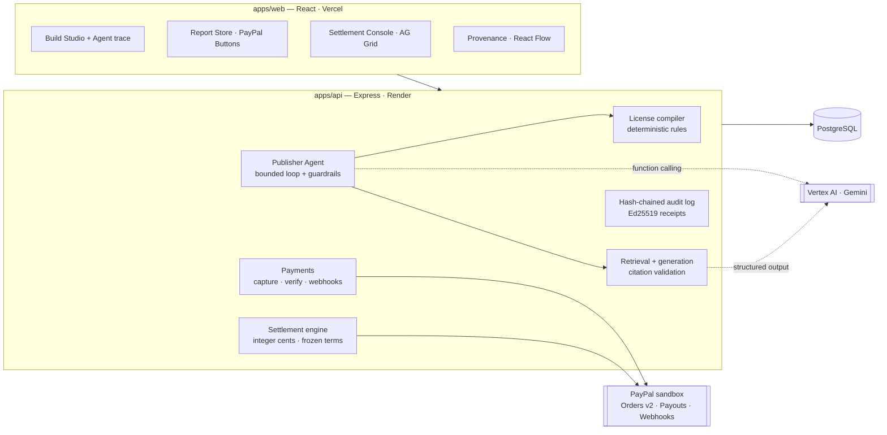

# TracePay

**The license compiler and settlement engine for AI-generated products.**

An AI can assemble a paid deliverable out of a dozen licensed sources in seconds. Nothing today checks whether those licenses actually allow that *specific* product to be sold, records which sources the output really used, or pays each contributor their agreed share when it sells. TracePay connects those three steps — and uses **PayPal** to collect the sale and pay the contributors.

> Built for the *Build What's Next with PayPal and AI* hackathon. Everything runs on the **PayPal sandbox** with **synthetic, fictional** demo data.


---

## The story in 60 seconds

**Atlas Research Studio** wants to sell a *Developer Tools Market Brief* for **$20**, built from three licensed sources.

1. **Preflight blocks it.** One source — the *Kestrel Enterprise Panel* — is licensed for *internal research only*. TracePay's deterministic license compiler refuses the commercial build (`PURPOSE_ALLOWED`, `COMMERCIAL_USE`).
2. **The Publisher Agent recovers.** A Gemini agent finds a compatible replacement (*Open Developer Survey Digest*, $2 per sale), asks the publisher for approval, re-runs preflight — now **PASS** — and generates the report. It cannot override a failed rule, change the price, or move money.
3. **Every claim is traceable.** Each finding cites `[C1]`, `[C4]`… which resolve to the exact retrieved passage. Invented citations are rejected.
4. **A buyer pays with PayPal.** The server creates the order, captures it, and verifies amount, currency and sale reference against PayPal's response.
5. **Contributors are paid automatically — under the terms frozen at build time.**

   | Recipient | Rule (approved license) | Amount |
   |---|---|---|
   | Northwind Data Co. | 25% of gross | $5.00 |
   | Mara Okafor (analyst) | 15% of gross, *only if cited* | $3.00 |
   | Lumen Collective | $2.00 fixed per sale | $2.00 |
   | Atlas (publisher, merchant of record) | residual | $10.00 |

   After the publisher approves, one **PayPal Payouts** batch pays all three; statuses are read back from PayPal until each item reports `SUCCESS`.
6. **A signed receipt proves it.** One Ed25519-signed document links source versions → rights check → artifact → PayPal capture → settlement formula → payout status, on top of a hash-chained audit log.

---

## What makes it different

The innovation isn't splitting $20 — many systems can do that. It's that **the financial structure of the product is derived from its verified dependency trail**:

- **Rights are checked against the intended use, not just "has a license".** The same dataset can be allowed in a derived report and blocked the moment you add a raw-data appendix (`RAW_REDISTRIBUTION`).
- **Provenance drives payment.** A license can pay only when the final output *cites* the source; retrieved-but-uncited sources get $0 with a recorded reason.
- **Terms are frozen per build.** If a contributor raises their royalty next month, past sales still settle under the terms in force when the report was built.
- **Evidence is never blurred.** Every node in the provenance graph is labeled as *verified by PayPal*, *recorded event*, *AI interpretation*, or *contractual* — a model's claim is never presented as a fact.

---

## Screens

| | |
|---|---|
| **Build Studio** — rules × sources preflight matrix, Publisher Agent with live trace and approval card | **Provenance Explorer** — React Flow graph from source versions to payouts, colour-coded by evidence |
| **Report** — clickable citation chips open the cited passage | **Settlement Console** — AG Grid ledger: formula per line, payable flags, live PayPal payout status, pinned totals |
| **Report Store** — PayPal Smart Buttons, server-verified capture | **Audit Receipt** — signed, verifiable, downloadable |

---

## How PayPal is used

| PayPal capability | Where | Why it matters |
|---|---|---|
| **OAuth 2.0** client credentials | `integrations/paypal/client.ts` | Token caching; **Payouts scope detection** before promising payouts |
| **Orders v2** — create | `POST /api/checkout/orders` | Created server-side with `reference_id` = `custom_id` = sale id; `PayPal-Request-Id` idempotency |
| **Orders v2** — capture + get | `POST /api/checkout/:saleId/capture` | Server captures, then **verifies** amount, currency and `custom_id` under a row lock; handles `ORDER_ALREADY_CAPTURED` |
| **JS SDK Smart Buttons** | `apps/web/src/pages/Store.tsx` | Buyer approval only; the browser never decides payment state |
| **Payouts** — create batch | `POST /api/settlements/:id/payouts` | One batch per settlement; deterministic `sender_batch_id` recorded **before** the call, so a retry can never pay twice |
| **Payouts** — batch status | `POST /api/settlements/:id/refresh` | "Accepted" ≠ "paid": a run completes only when every item is `SUCCESS`; `FAILED`/`RETURNED`/… become exceptions |
| **Webhooks** + signature verification | `POST /api/webhooks/paypal` | Raw-body verification via `verify-webhook-signature`; deduped by event id; handles `PAYMENT.CAPTURE.COMPLETED/REFUNDED/REVERSED/DENIED` and payout events (status re-read from PayPal, never trusted from the payload) |

## How AI is used (Vertex AI · Gemini)

| Role | What the model does | What it is **not** allowed to do |
|---|---|---|
| **Publisher Agent** (function calling) | Plans the build, calls 7 TracePay tools (`run_license_preflight`, `find_compatible_replacement`, `propose_replacement`, `generate_report`, …), recovers from a blocked plan | Override the compiler, preflight unapproved sources, change price/purpose, touch money — enforced in code, not in the prompt |
| **Report writer** (structured output) | Synthesises findings from retrieved passages with `[Cn]` citation markers | Cite anything not retrieved (validated; one repair attempt, then rejected) |
| **Explainer** | Turns failed rules into plain language for the publisher | Change the verdict — the compiler's decision is returned, never the model's |

When Vertex AI isn't configured, TracePay falls back to a **rule-based planner** and an **extractive fixture writer**. Both are clearly labeled in the UI and in the receipt (`fromFixture: true`) and are never presented as model output.

---

## Architecture



**Money rules enforced in code:** integer cents only · only a verified captured sale creates a settlement · one settlement per sale · percentages over 100% are rejected, never normalized · publisher approval before payouts · retries reuse the same idempotency key · refunds/reversals flag the settlement as an exception.

---

## Real vs. simulated

| Real | Simulated / demo-only |
|---|---|
| PayPal sandbox Orders, capture, Payouts, webhooks | All sources, contributors and numbers are fictional |
| License compiler, settlement engine, audit chain, signatures | Authentication: a **demo-only role switcher** (`X-Demo-User`), no passwords |
| Vertex AI Gemini agent + writer (when configured) | Fixture writer / rule-based planner when Vertex is not configured — always labeled |
| PostgreSQL persistence | "Reset demo" restores TracePay fixtures; it does **not** reverse PayPal sandbox history |

TracePay enforces recorded, approved license terms. It does not establish legal ownership of source material, is not legal advice, and is not an escrow service — the publisher receives the payment and then pays contributors.

---

## Run it locally

**Prerequisites:** Node 20.19+ (24 recommended), Docker, a PayPal Developer account. Vertex AI is optional.

```bash
git clone https://github.com/UjjwalCodes01/TracePay.git && cd TracePay
npm install
npm run db:up                                  # Postgres 17 on localhost:5433

cp apps/api/.env.example apps/api/.env         # then fill in the values below
npm run keys:generate -w @tracepay/api         # paste AUDIT_SIGNING_PRIVATE_KEY into .env

npm run db:deploy -w @tracepay/api             # apply migrations
npm run db:seed -w @tracepay/api               # load the demo world

npm run dev:api                                # http://localhost:4000
npm run dev:web                                # http://localhost:5173
```

### Environment (`apps/api/.env`)

| Variable | Required | Notes |
|---|---|---|
| `PAYPAL_CLIENT_ID`, `PAYPAL_CLIENT_SECRET` | yes | **Sandbox** REST app. Enable *Payouts* in the app's features |
| `DEMO_PAYEE_EMAILS` | for payouts | Three sandbox **personal** account emails (Northwind, Okafor, Lumen) |
| `PAYPAL_WEBHOOK_ID` | for webhooks | Register `https://<api>/api/webhooks/paypal` in the dashboard |
| `GOOGLE_CLOUD_PROJECT`, `VERTEX_MODEL` | for live AI | Plus `gcloud auth application-default login` locally, or `GOOGLE_SERVICE_ACCOUNT_JSON` on a server |
| `AUDIT_SIGNING_PRIVATE_KEY` | yes | Ed25519 key from `npm run keys:generate` |

Check your PayPal setup before running the app:

```bash
npm run smoke:paypal -w @tracepay/api -- token          # auth + Payouts scope
npm run smoke:paypal -w @tracepay/api -- order          # prints an approval link
npm run smoke:paypal -w @tracepay/api -- capture <ORDER_ID>
npm run smoke:vertex -w @tracepay/api                   # Gemini structured output
```

### Demo walkthrough

1. **Publisher** → *Build Studio* → keep the default three sources → **Run agent**. Watch it get blocked, propose a replacement, and wait for you. **Approve** → report ready.
2. Open the report → click a citation chip → **Provenance**.
3. Switch role to **Buyer** → *Report Store* → **Pay with PayPal** (sandbox buyer account) → the report unlocks with the server-verified capture.
4. Switch back to **Publisher** → *Settlement Console* → **Approve** → **Send PayPal payouts** → **Refresh from PayPal**.
5. Open the **Audit Receipt** → **Verify signature**. Switch to a **Contributor** to see their own settlement record.

---

## Tests

```bash
npm run test:integration -w @tracepay/api   # 61 tests; creates/migrates a tracepay_test database
```

| Suite | Covers |
|---|---|
| License compiler (14) | block/pass, replacement, internal-only, raw-redistribution adversarial case, expiry, territory, >100% royalties, determinism |
| Settlement engine (9) | exact $20 split, reconciliation for any amount, paid-only-if-cited, fixed fees, rejection cases |
| Citations · audit · signing · money (7) | invented citation rejected, hash chain tamper detection, signature tamper detection, decimal ↔ cents |
| PayPal client (5) | same idempotency key on retry, no retry on 4xx, raw-body webhook verification, Payouts scope |
| Build pipeline (5) | recorded blocked builds, retrieval scoped to approved sources, citation integrity |
| Money path (13) | capture before approval, duplicate webhooks, webhook-before-response, forged signature, amount mismatch, **frozen terms after a license edit**, pending ≠ paid, failed/returned items, **lost payout response never pays twice**, missing Payouts permission, refunds |
| Publisher agent (5) | recovery, approval pause, decline, guardrail violations, turn limit |
| HTTP end-to-end (3) | the full demo script, the agent with an approval pause, and a forged webhook — through the REST API |

---

## Project layout

```
apps/api      Express API, Prisma schema & migrations, services, tests
apps/web      React app (Vite, Tailwind, React Router, TanStack Query, AG Grid, React Flow)
packages/shared  Money helpers and zod schemas shared by API and web
render.yaml   Render Blueprint (API + Postgres); apps/web/vercel.json for the frontend
```

## Tools used

- **PayPal Developer Platform (sandbox):** Orders v2, JS SDK Smart Buttons, Payouts, Webhooks.
- **Google Vertex AI (Gemini):** function-calling agent, structured-output report writer, failure explanations — via `@google/genai`.
- **AG Grid Community:** registry and settlement ledger. **React Flow:** provenance graph.
- **Render** (API + Postgres) and **Vercel** (web).
- Node.js, TypeScript, Express 5, Prisma 7, PostgreSQL 17, React 19, Tailwind CSS 4, Vitest.

## License

[MIT](LICENSE)
