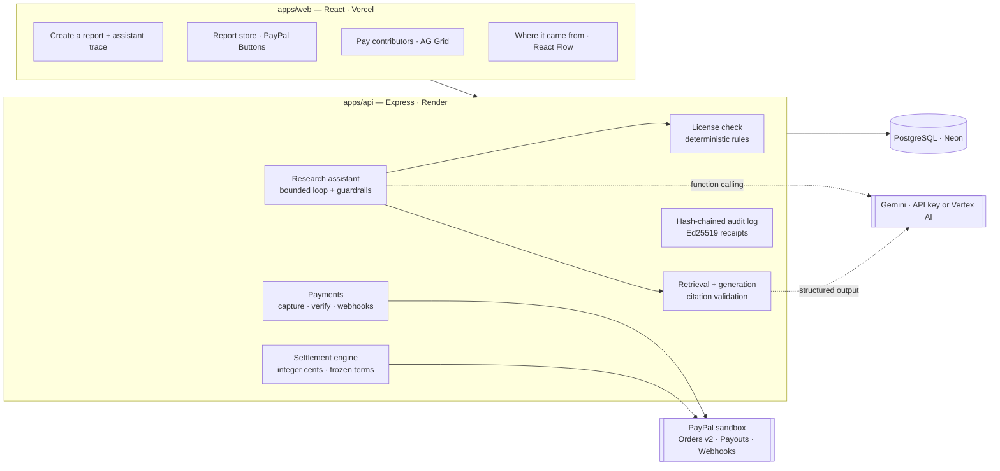

# How TracePay works

[README](../README.md) · [How it works](how-it-works.md) · [PayPal](paypal.md) · [Running it](running.md) · [Tests](testing.md)

## Pay-per-citation: AI answers that pay the people they rely on

How an answer is checked, priced and paid:

1. A buyer, or their AI agent (Claude Desktop through our MCP server, or any app through the API), holds **prepaid credit bought with PayPal**.
2. They ask a question and set the most it may cost.
3. A **license check** (fixed rules, no AI) decides which sources may be used: only licenses that allow AI answers, are current, allow commercial use and have a contributor who can be paid. Revoked, expired or "no AI" sources are never even retrieved.
4. Sources are **fitted to the price limit before the model runs**, at their worst-case cost, and that amount is held from the balance — so an answer can never cost more than the limit, and concurrent answers can never overspend.
5. Gemini writes the answer from those passages only, citing `[C1]`, `[C2]`…
6. **Citations are audited, not trusted.** An invented source rejects the answer (free). A citation is paid only if its sentence really draws on the passage; each passage is paid once, at most 3 per source. A small fee goes to the library.
7. A separate AI judge checks every citation (embeddings as a floor, then Gemini seeing only the sentence and the passages it cites); only citations it confirms are paid. A sentence that combines two sources pays both; a source cited as padding, or a sentence that adds a claim none of its sources make, pays nothing. Each contributor's earnings add up; the library pays them in one **PayPal Payouts** batch (idempotent, failed items return to the pool). The asker gets an **Ed25519-signed receipt** of who was paid, under which license terms — and of every citation verdict with its reason, and exactly which judge made them (version, model, SHA-256 of its instructions, temperature). **Verify** checks the signature in your own browser (WebCrypto Ed25519 — TracePay's servers aren't asked), then *Change 1¢ and check* shows an edited copy failing. TracePay's signing key: SHA-256 fingerprint `2950 8e50 1ab6 79c5 be64 c004 486b 9a0f c66a 693b 2f69 ae28 caa9 5165 8ab3 242d` (served at `/api/audit/public-key`).

   *Can a model's payout decision be disputed?* A model can't be re-run bit for bit, so TracePay doesn't pretend it can: the receipt is the record. It fixes what was decided, by which judge and instructions, and why, for each sentence (hashed) and passage (by id). A contributor who disputes a verdict points to that line, and the library reviews it against the same judge version, sentence and passage (today by hand). Receipts and the credit ledger are append-only, so a correction is a new entry beside the original, never an edit to it. Two guardrails make a wrong verdict cheap: the embedding floor means nothing unrelated is ever paid whatever the model says, and the most any verdict moves is one passage's per-citation rate (2¢ in the demo).

**Red team — "Can the AI be gamed?"** A larger model than the defences, `gemini-3.1-pro-preview`, plays the attacker (`npm run red-team`) so the two don't share blind spots, writing fresh attacks against the two AI checks (which run on `gemini-3.5-flash`). Three independent rounds, added together — one round swings too much to quote: **75/75 planted instructions withheld**, **90/90 unsupported citations refused**, **27/30 padded citations refused**, **30/30 sentences combining two sources paid to both**, 55/60 honest paraphrases paid, and **57/57 passages of real published text left alone** — abstracts of prompt-injection papers and Creative Commons clauses ("You must…"), [with sources](../apps/api/fixtures/red-team/honest-controls.json) — plus 38/45 look-alikes the attacker wrote to be mistaken for instructions. Every miss is published on the Ask page with the checker's reason. Separately, the money rules that need no AI (budget held before the model runs, padding, invented sources, per-source cap, verbatim copying) are checked on every request.

**Built so nobody can game it:** an unpaid answer never returns its text (no free licensed content); passages that try to instruct the model are withheld from it; answers that copy a source word for word are rejected (licenses forbid raw redistribution); demo credit only ever pays the demo's own contributors; royalties wait a clearing period before payout, and a refund or chargeback claws back the ones its money funded.

| Who | Where |
|---|---|
| Buyer / AI agent | *Ask the library* · `POST /api/v1/answers` (402 when credit runs out) · MCP tool `ask_library` |
| Contributor | License terms gain an *AI answers* clause (cents per cited passage); *My earnings → From AI answers* |
| Library (publisher) | *Answer royalties*: owed per contributor, one-click PayPal payout, statuses read back from PayPal |

---

## Also included: licensed reports, sold with PayPal

**Atlas Research Studio** wants to sell a *Developer Tools Market Brief* for **$20**, built from three licensed sources.

1. **The license check blocks it.** One source — the *Kestrel Enterprise Panel* — is licensed for *internal research only*. TracePay's license check (fixed rules, no AI) refuses a report that will be sold.
2. **The research assistant recovers.** It asks the license check which sources would pass in place of the blocked one; those come back ranked by relevance to the brief, then cost. It proposes the best — a **real paper under CC BY 4.0** (*Sea Change in Software Development*, Dohmke, Iansiti & Richards, 2023: free, with a credit line) — asks the publisher for approval, re-runs the license check — now **passed** — and writes the report. It cannot override a failed rule, change the price, or move money.
3. **Every claim is traceable.** Each finding cites `[C1]`, `[C4]`… which resolve to the exact retrieved passage. Invented citations are rejected.
4. **A buyer's AI pays for them — within a mandate.** The buyer **saves PayPal once for their shopping assistant with a spending mandate** (most per purchase, most in total, an end date; PayPal Vault). The assistant (Gemini) searches the store for what they asked for, re-runs the license check on each candidate, checks its citations, picks one and **pays on its own** — the mandate checked on the server before every charge, the amount reserved under a lock so two purchases can't both squeeze in. Without a mandate it proposes and the buyer approves in PayPal. Either way, the server creates the PayPal order, takes the payment, and verifies amount, currency and sale reference against PayPal's response.
5. **Contributors are paid automatically — under the license terms in force at the moment of sale.**

   | Recipient | Rule (approved license) | Amount |
   |---|---|---|
   | Northwind Data Co. | 25% of each sale | $5.00 |
   | Mara Okafor (analyst) | 15% of each sale, *only if cited* | $3.00 |
   | Dohmke, Iansiti & Richards (arXiv:2306.15033) | CC BY 4.0: free, credited in the report | $0.00 |
   | Atlas (the publisher, who sold it) | what's left | $12.00 |

   After the publisher approves, one **PayPal Payouts** batch pays the contributors who are owed; statuses are read back from PayPal until each item reports `SUCCESS`.
6. **A signed receipt proves it.** One Ed25519-signed document links source versions → license check → report → PayPal payment → payment split → payout status, on top of a hash-chained audit log.

---

## Real licenses, not just made-up ones

Alongside its fictional commercial sources, the demo library holds **five real open-access papers on AI coding assistants, under their actual licenses** (the stored passages are their arXiv abstracts, which arXiv releases as CC0; each paper's own license governs its use):

| Paper | License | What TracePay does |
|---|---|---|
| Ziegler et al., 2022 (arXiv:2205.06537); Dohmke, Iansiti & Richards, 2023 (arXiv:2306.15033) | CC BY 4.0 | Used in paid answers and reports for free, **with the credit line the license requires** |
| Nam et al., 2023 (arXiv:2307.08177) | CC BY-NC-SA 4.0 | Left out of anything sold: "The license doesn’t allow use in anything that is sold (CC BY-NC-SA 4.0)" |
| Sarkar et al., 2022 (arXiv:2208.06213) | CC BY-NC-ND 4.0 | No AI answers (an answer is an adaptation) and no reports |
| Peng et al., 2023 (arXiv:2302.06590) | arXiv's distribution-only license | No license to reuse it: it is never a candidate, never shown to a model |

Their authors haven't joined TracePay, so nothing is paid to them and no account speaks for them; the payment side of the demo uses the fictional contributors.

## What makes it different

The innovation isn't splitting $20 — many systems can do that. It's that **the financial structure of the product is derived from its verified dependency trail**:

- **Rights are checked against the intended use, not just "has a license".** The same dataset can be allowed in a derived report and blocked the moment you add an appendix of the original data.
- **Where it came from drives payment.** A license can pay only when the final output *cites* the source; retrieved-but-uncited sources get $0 with a recorded reason.
- **Rights are re-checked at every sale, and terms are frozen per sale.** A report keeps selling only while every source's license still permits it; a revoked or expired license takes it off sale. Each sale settles under the terms in force when it happened — later renegotiations never rewrite it.
- **Answers pay per verified citation.** Pay-per-citation turns the same dependency trail into a royalty stream for AI answers — with the price limit enforced before the model runs.
- **Evidence is never blurred.** Every node in the *Where it came from* graph is labeled as *verified by PayPal*, *recorded event*, *AI interpretation*, or *contractual* — a model's claim is never presented as a fact.

## How AI is used (Gemini)

| Role | What the model does | What it is **not** allowed to do |
|---|---|---|
| **Research assistant** (function calling, publisher side) | Plans the build, calls 7 TracePay tools (`run_license_preflight`, `find_compatible_replacement`, `propose_replacement`, `generate_report`, …), recovers from a blocked plan | Override the license check, check unapproved sources, change price/purpose, touch money — enforced in code, not in the prompt |
| **Shopping assistant** (function calling, buyer side) | Searches the store, compares and inspects candidates (fresh license check, citation check) and decides which report best serves the buyer — and, within the buyer's **spending mandate**, buys it with their saved PayPal | Exceed the budget or the mandate, see the saved wallet, or buy a report it hasn't verified, already owned or off sale — enforced in code; outside the mandate the buyer approves in PayPal |
| **Answer writer** (structured output, pay-per-citation) | Answers a question from licensed passages only, citing `[Cn]` | Decide who is paid: an independent judge does, and the money rules (retrieved, de-duplicated, capped, within the asker's limit) are code; text inside a source is data, never instructions |
| **Citation judge** (embeddings + structured output) | For each sentence, decides passage by passage whether it really draws on each passage it cites — naming the fact each one supplies and any claim none of them make (paraphrases and combined sources count; topic-only, padded, misquoted and embellished claims don't), with a plain reason | See the question, prices or names; overrule the semantic floor (`gemini-embedding-001`), below which nothing is paid |
| **Passage screen** (structured output) | Reads each source passage once, in any language, and flags text addressed to AI systems (planted instructions) so it is never shown to a writer | Be skipped: without a verdict the pattern list decides |
| **Red team** (`npm run red-team`) | Plays the attacker on a different, larger model (`gemini-3.1-pro-preview`): writes fresh planted instructions, unpayable and padded citations, plus honest controls (including sentences combining two sources), to score the screen and the judge | Grade itself: the real defences run at temperature 0 and every miss is published |
| **Report writer** (structured output) | Synthesises findings from retrieved passages with `[Cn]` citation markers | Cite anything not retrieved (validated; one repair attempt, then rejected) |
| **License drafter** (structured output) | Reads a contributor's license document and drafts normalized terms with a verbatim quote per field | Bind anyone — both parties confirm; quotes not found in the document are flagged |
| **Explainer** | Turns failed rules into plain language for the publisher | Change the verdict — the license check's decision is returned, never the model's |

When no Gemini model is configured (neither `GEMINI_API_KEY` nor Vertex AI), TracePay falls back to a **rule-based planner** and an **extractive fixture writer**. Both are clearly labeled in the UI and in the receipt (`fromFixture: true`) and are never presented as model output.

## Architecture

**Money rules enforced in code:** integer cents only · only a verified captured sale creates a settlement · one settlement per sale · percentages over 100% are rejected, never normalized · publisher approval before payouts · retries reuse the same idempotency key · refunds/reversals flag the settlement as an exception.
